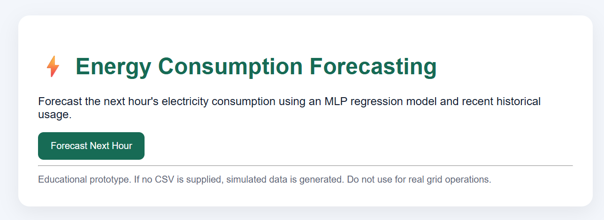
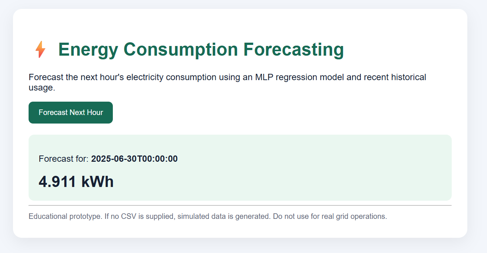
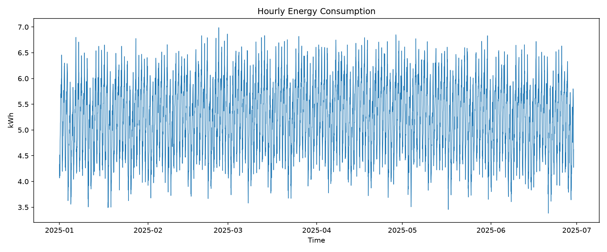
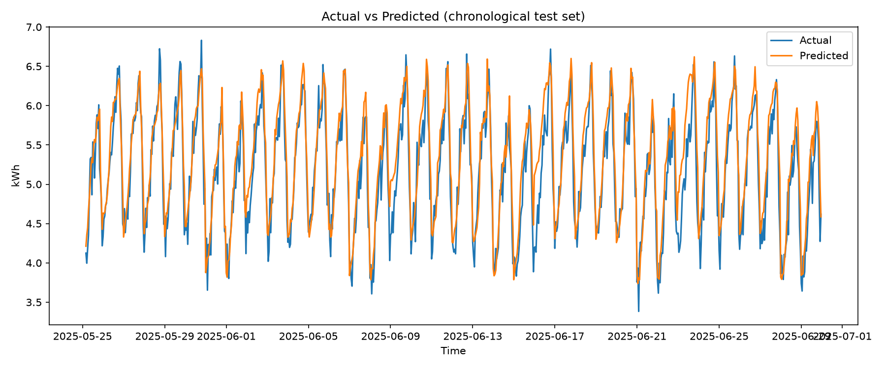

# ⚡ AI-Powered Energy Consumption Forecasting System

A machine learning project that analyzes historical energy consumption data and predicts future energy usage. It uses Python, Pandas, NumPy, and Scikit-learn to train a forecasting model and Flask to provide a simple web interface.

## 📌 Project Overview

Energy consumption forecasting helps users understand usage patterns and estimate future electricity demand. This project demonstrates how machine learning can be applied to historical energy consumption data to predict the next hour's energy usage.

The system includes data preprocessing, time-based feature engineering, model training, evaluation, visualization, and a Flask web application.

**Note:** The current project uses synthetic demonstration data unless a real dataset is supplied. Results from synthetic data do not establish real-world forecasting accuracy.

## 🎯 Objectives

* Analyze historical energy consumption data.
* Create time-based features for forecasting.
* Train a machine learning regression model.
* Predict energy consumption for the next hour.
* Evaluate predictions using standard regression metrics.
* Visualize energy consumption and prediction results.
* Provide a simple web interface for making forecasts.

## 🛠️ Technologies Used

| Technology   | Purpose                               |
| ------------ | ------------------------------------- |
| Python       | Core programming language             |
| Pandas       | Data manipulation and preprocessing   |
| NumPy        | Numerical operations                  |
| Scikit-learn | Machine learning and model evaluation |
| MLPRegressor | Neural-network-based regression       |
| Matplotlib   | Data visualization                    |
| Joblib       | Saving and loading the trained model  |
| Flask        | Web application                       |
| HTML         | Web interface                         |

## 🏗️ Project Structure

```text
AI-Energy-Forecasting/
│
├── data/
│   └── energy_consumption.csv
│
├── models/
│   └── energy_forecast_model.joblib
│
├── outputs/
│   ├── energy_consumption.png
│   ├── actual_vs_predicted.png
│   ├── evaluation_metrics.json
│   └── predictions.csv
│
├── screenshots/
│   ├── homepage.png
│   ├── prediction-result.png
│   ├── energy_consumption.png
│   ├── actual_vs_predicted.png
│   └── Training completed. Metrics.png
│
├── src/
│   ├── data_utils.py
│   ├── predict.py
│   └── train.py
│
├── templates/
│   └── index.html
│
├── docs/
│   └── PROJECT_NOTES.md
│
├── app.py
├── main.py
├── requirements.txt
├── .gitignore
└── README.md
```

Generated datasets, model files, and evaluation outputs may be excluded from Git by `.gitignore`. The structure above describes the project's intended working files.

## 🔄 System Workflow

1. **Data Collection:** Load historical energy consumption data or generate demonstration data.
2. **Data Preprocessing:** Prepare the data for machine learning.
3. **Feature Engineering:** Create time-based features, lag features, and rolling averages.
4. **Model Training:** Train an MLPRegressor model using a chronological training and testing split.
5. **Model Evaluation:** Calculate MAE, RMSE, and R² to evaluate prediction performance.
6. **Prediction:** Use the trained model to estimate energy consumption for the next hour.
7. **Visualization:** Generate charts to understand consumption patterns and compare actual and predicted values.
8. **Deployment:** Use Flask to access the forecasting functionality through a web interface.

## 📊 Model Evaluation

The following results were obtained during a training run using the project's demonstration dataset.

| Metric                         |     Result |
| ------------------------------ | ---------: |
| Total rows                     |      4,320 |
| Training rows                  |      3,436 |
| Testing rows                   |        860 |
| Mean Absolute Error (MAE)      | 0.2314 kWh |
| Root Mean Squared Error (RMSE) | 0.2953 kWh |
| R² Score                       |     0.8286 |
| Baseline Mean MAE              | 0.6108 kWh |

**Interpretation:** In this run, the model achieved an R² score of approximately 0.829. Its MAE was lower than that of the mean-baseline predictor on the same test split.

These results are specific to the dataset used for this run. They should not be interpreted as evidence of equivalent accuracy on real-world energy consumption data.

## 🖥️ Screenshots

### 1. Web Application Homepage



### 2. Forecast Prediction Result



### 3. Energy Consumption Graph



### 4. Actual vs. Predicted Consumption



### 5. Model Training Metrics


## ⚙️ Installation and Setup

### Prerequisites

* Python 3.10 or a compatible Python version
* Git
* A code editor such as Visual Studio Code

### Step 1: Clone the repository

```bash
git clone https://github.com/chandralekhayatham/AI-Energy-Consumption-Forecasting.git
```

### Step 2: Enter the project directory

```bash
cd AI-Energy-Consumption-Forecasting
```

### Step 3: Create a virtual environment

```bash
python -m venv .venv
```

### Step 4: Activate the environment

**Windows PowerShell:**

```powershell
.\.venv\Scripts\Activate.ps1
```

### Step 5: Install dependencies

```bash
python -m pip install -r requirements.txt
```

### Step 6: Train the model

```bash
python main.py train
```

This command trains the model and generates evaluation metrics, predictions, and charts.

### Step 7: Generate a forecast

```bash
python main.py predict
```

### Step 8: Start the web application

```bash
python main.py web
```

Open the local address displayed in the terminal. The default address is typically
